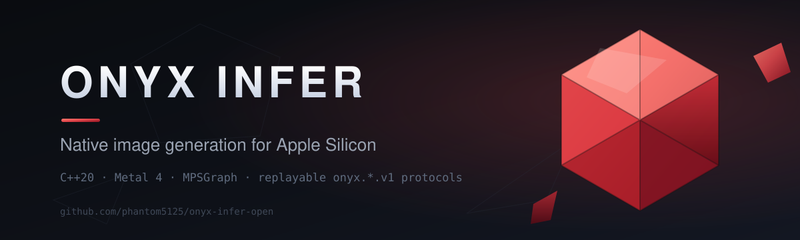
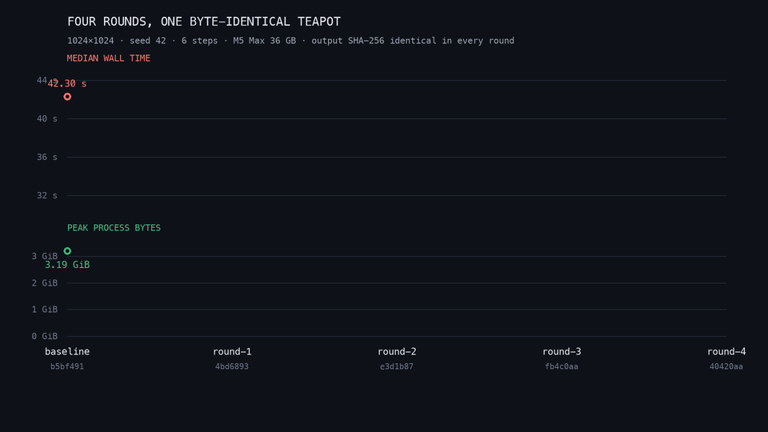

<p align="center">
  <picture>
    
  </picture>
</p>

<p align="center">
  <a href="https://github.com/phantom5125/onyx-infer/actions/workflows/ci.yml"></a>
  
  
  
  <a href="LICENSE"></a>
  <a href="README.zh-CN.md">Chinese README</a>
  <a href="https://phantom5125.github.io/onyx-infer/"></a>
</p>

# onyx-infer

Generate **4096×4096 images directly on Apple Silicon** with MiniMax-H3-Image. Onyx Infer runs the text encoder, 33.1B DiT, and VAE locally in C++20 and Metal 4. The 4K path has been verified on a Mac Studio with an M5 Max and 36 GB of unified memory.

[Quick start](#quick-start) · [Choose a profile](#choose-a-profile) · [Deep evaluation](#deep-evaluation) · [Onyx Studio](plugin/onyx-studio/README.md)

The six-step 4096×4096 teapot benchmark took 329.6 s on the 36 GB M5 Max. The 1024×1024 benchmark took a median 175 s on a 24 GB M4 MacBook Air on battery. [M5 Max benchmark](benchmarks/results/native-v1-stability.json) · [M4 Air benchmark](benchmarks/results/m4-air-24gb-dit-prefetch-v1.json)

PyTorch and Diffusers support offline import and reference validation. Native generation uses MPSGraph and Metal kernels.

## Quick start

Four steps from clone to a native 1024×1024 image. The full guide with troubleshooting lives in [docs/QUICKSTART.md](docs/QUICKSTART.md).

**1. Build the native runtime**

```bash
git clone --branch v0.4.0 https://github.com/phantom5125/onyx-infer.git
cd onyx-infer
uv sync --frozen --no-dev
uvx --from cmake cmake -S . -B .build -DCMAKE_BUILD_TYPE=Release -DONYX_ENABLE_MLX=OFF
uvx --from cmake cmake --build .build --target onyx-native --parallel 8
```

**2. Download the pinned checkpoint and convert it to W4**

```bash
uv run --frozen --no-dev python tools/modelscope_fetch.py \
  --source-lock config/sources/h3-image-files.json --directory artifacts/models/h3-image-source
uv run --frozen --no-dev onyx import \
  --source artifacts/models/h3-image-source --lock config/sources/h3-image-files.json \
  --output artifacts/models/h3-original-meta
uv run --frozen --no-dev onyx quantize --source artifacts/models/h3-image-source \
  --component text_encoder --all-linear --output artifacts/models/h3-w4/text_encoder.onxpack
uv run --frozen --no-dev onyx quantize --source artifacts/models/h3-image-source \
  --component transformer --all-linear --output artifacts/models/h3-w4/transformer.onxpack
uv run --frozen --no-dev onyx package-w4 --source artifacts/models/h3-image-source \
  --original-manifest artifacts/models/h3-original-meta/manifest.pb --output artifacts/models/h3-w4
```

**3. Generate**

```bash
uv run --frozen --no-dev onyx native-generate \
  --models artifacts/models/h3-w4 \
  --prompt "A yellow enamel teapot on a blue wooden table." \
  --width 1024 --height 1024 --seed 42 \
  --output artifacts/native-output.png
```

**What you need**

- **System** — Apple Silicon, macOS 26.2 or later, the Xcode Metal 4 toolchain, and `uv` with Python 3.12 or later.
- **Disk** — About **62 GB** of W4 inference files. Allow about **200 GB** with the original checkpoint, plus space for build tools.
- **Memory** — Tested at 1024×1024 on 24 GB (M4 Air) and 36 GB (M5 Max) Macs. The minimum supported unified memory is unverified.
- **Time** — Expect about 35–43 s per 1024×1024 image on an M5 Max, about 175 s on an M4 Air. Measured numbers below.

## Choose a profile

One W4 model, three execution profiles. The profile only changes the execution plan — weights, sampler, and seed stay the same, so the choice is about memory and speed, not image identity. [Registry](config/profiles/profiles.v1.json) · [Gate rules](docs/PROFILES.md)

| Profile | Execution plan | Pick it when | Measured VAE stage (M5 Max) |
| --- | --- | --- | --- |
| `max-quality` (default) | Text and DiT stream; VAE resident; MPSGraph FP32 dequant | You want the path with the best measured end-to-end time | 6.30 s @1024 · 85.23 s @4096 |
| `memory-min` | Every stage streams, including the VAE | You want the lowest footprint; output is bitwise identical to `max-quality` | 10.25 s @1024 · 155.28 s @4096 |
| `speed-focus` | BF16 SIMD Q4 kernel + 24 GiB DiT LRU cache | You are experimenting with kernel and cache variants | 5.55 s @1024 · 97.40 s @4096 |

How to read the numbers: the VAE-stage matrix above used FP32 source weights, three rotated samples per configuration, on the 36 GB reference machine. End to end, the default MPSGraph path is still the fastest measured W4 pipeline — `speed-focus` is a testbed, not a shortcut. The `memory-min` stream-everything plan pays about 63% more VAE time at 1024×1024 and 82% more at 4096×4096 in exchange for never holding VAE weights resident, and its output matches `max-quality` byte for byte (that is a hard gate, not a hope).

Run with an explicit profile:

```bash
uv run --frozen --no-dev onyx native-generate --profile memory-min \
  --models artifacts/models/h3-w4 --prompt "..." --width 1024 --height 1024 --seed 42 \
  --output artifacts/native-output.png
```

For repeated generation, `--modulation-cache <directory>` reuses the six-step DiT modulation tables across prompts, seeds, and sizes (38.21 s vs 43.14 s median on the benchmark machine). At 1024×1024 on 36 GB, `--dit-cache-mib 10240` caches repeatedly read weights; the same budget increased swap at 16 MP. [Tuning and verification](docs/NATIVE_TUNING.md)

## Why it exists

The checkpoint is ~135 GB. The machine grants a 28.08 GiB working set. That gap dictates
everything: group-wise W4 weights, phase residency, block streaming, chunked attention —
and an engine that plans memory explicitly instead of hoping unified memory sorts it out.

## Optimization leaderboard

Each row uses the same 1024×1024 teapot request on the M5 Max with 36 GB of unified memory
(seed 42, six sampling steps). All four candidates matched the baseline PNG byte for byte.
The benchmark records include sample counts, output hashes, and the source revision.

| Configuration | Median wall time | Peak memory | Speed vs. baseline | Evidence |
| --- | ---: | ---: | ---: | --- |
| Native streaming baseline | 42.30 s | 3.19 GiB | 1.00× | [Baseline measurements](benchmarks/results/native-round1-zero-cache.json) |
| Grouped Q4 zero-point cache | 42.63 s | 3.18 GiB | 0.99× | [Measurement](benchmarks/results/native-round1-zero-cache.json) |
| Direct reads into Metal buffers | 38.74 s | 1.70 GiB | 1.09× | [Measurement](benchmarks/results/native-round2-direct-pread.json) |
| Shared-memory BF16 modulation packing | 37.50 s | 1.70 GiB | 1.13× | [Measurement](benchmarks/results/native-round3-cpu-modulation.json) |
| Fused DiT attention and tensor views | **34.65 s** | 1.86 GiB | **1.22×** | [Measurement](benchmarks/results/native-round4-fused-attention-views.json) |

<picture>
  
</picture>

The chart is generated from the committed measurement JSONs — regenerate it with
`uv run python tools/build_progress_chart.py`. The [teapot benchmark write-up](site/blog/posts/four-rounds-one-byte-identical-teapot.md)
explains each change, including the zero-point cache regression.

## Deep evaluation

Everything below is produced by a committed measurement file in
[`benchmarks/results/`](benchmarks/results/) — including the gaps we have not closed yet.
The aggregated, machine-generated version of this report is [docs/BENCHMARKS.md](docs/BENCHMARKS.md).

### End to end, across machines and resolutions

Six-step W4 teapot requests, seed 42. RSS is sampled across the inference process tree.

| Machine | Request | Time | Peak memory | Evidence |
| --- | --- | ---: | ---: | --- |
| Mac Studio M5 Max · 36 GB | 1024×1024, best measured configuration | **34.65 s** median | 1.86 GiB | [native-round4](benchmarks/results/native-round4-fused-attention-views.json) |
| Mac Studio M5 Max · 36 GB | 1024×1024, default profile, caches off | 43.14 s median | 1.91 GB | [modulation-cache study](benchmarks/results/m5-max-36gb-dit-modulation-cache-v1.json) |
| Mac Studio M5 Max · 36 GB | 1024×1024, modulation cache hit | 38.21 s median | 1.92 GB | [modulation-cache study](benchmarks/results/m5-max-36gb-dit-modulation-cache-v1.json) |
| Mac Studio M5 Max · 36 GB | 4096×4096 | 329.61 s stability run; 302.26 s single run on the current binary | 2.14 GB | [native-v1-stability](benchmarks/results/native-v1-stability.json) · [4096 compatibility pair](benchmarks/results/m5-max-36gb-dit-modulation-cache-v1.json) |
| MacBook Air M4 · 24 GB · battery | 1024×1024 | 174.98 s median | 1.92 GB | [m4-air-24gb](benchmarks/results/m4-air-24gb-dit-prefetch-v1.json) |

A note on numbers you may have seen elsewhere: kernel-episode write-ups quote
DiT-only extrapolations (block milliseconds × 300) from an isolated profiler with
warm weights — for example a 20.1 s "DiT" figure on 2026-11-24, while the real
end-to-end DiT median that day was 31.89 s. The gap is streaming weight reads
(85.7 GB per 1024×1024 image), dispatch, and thermal drift. Only whole-image
measurements appear in this table.

### Where the time goes (1024×1024 teapot, median stage seconds)

| Machine | Text encoder | DiT (6 steps) | VAE decode |
| --- | ---: | ---: | ---: |
| M5 Max, baseline | 4.81 s | 33.24 s | 4.85 s |
| M5 Max, round 4 | 3.83 s | 26.02 s | 4.41 s |
| M4 Air, battery | 9.90 s | 143.48 s | 19.99 s |

The DiT stage is 75–82% of wall time everywhere, which is why the optimization loop
concentrates there and why the operator-level gap below matters more than any other.

### Operator level: Q4 GEMM vs MLX (published gap)

Same shapes as the H3 DiT/text towers, group size 64. The default pipeline does not
dispatch these standalone kernels — MPSGraph dequantizes and multiplies inside the
graph — so this table quantifies the kernel-level gap, not the production hot path.
Episode history: [`kernel-agent/candidates.jsonl`](kernel-agent/candidates.jsonl).

| Shape | Onyx tile16 (wall) | Onyx mma64, best hand-written (GPU) | MLX `quantized_matmul` (wall) | mma64 vs MLX |
| --- | ---: | ---: | ---: | ---: |
| linear m1024 · n5376 · k5376 | 28.12 ms | 8.45 ms | 1.71 ms | 4.9× |
| qkv m1024 · n21504 · k5376 | 109.77 ms | 33.25 ms | 5.48 ms | 6.1× |
| text qproj m69 · n8192 · k5120 | 3.29 ms (tile32: 2.44 ms) | — | 0.77 ms | 4.3× |

tile16 and MLX figures are wall-medians from the committed
[operator comparison](benchmarks/results/m5-max-36gb-q4-operator-v1.json) and
[tile32 study](benchmarks/results/m5-max-36gb-q4-tile32-v1.json); mma64 figures are
ABBA GPU-median episode evidence in `candidates.jsonl`. Three findings frame the gap:
episode e9 proved register-side dequant unreachable through the public simdgroup-MMA
API on the Metal 4 toolchain (MLX's edge likely comes from primitives outside that
API); at decode shapes (m≤32) our tile16 already beats MLX (0.47 ms vs 0.73 ms); and
an opt-in MLX backend (`ONYX_Q4_BACKEND=mlx`, builds with `ONYX_ENABLE_MLX=ON`)
reaches 4.10 ms on the linear shape for builds that accept the extra dependency.

### Against the community W8A8 path

Same 1024 teapot request: the community MLX pipeline (W8A8, resident) finishes in
23.61 s median with a 13.77 GB peak; native Onyx W4 takes 38.74 s at 1.70 GiB — 1.64×
slower at roughly one-eighth of the memory. Different quantization and execution, so
this is not an apples-to-apples speed claim; it is the next optimization target, and
it is published rather than omitted. [Comparison record](benchmarks/results/h3-teapot-1024-comparison-v1.json)

### Numerical fidelity

| Check | Result | Source |
| --- | --- | --- |
| Text tower vs FP32 reference | correlation 0.9999987 | `native-baseline-v1.json` |
| VAE decode vs FP32 reference | pixel correlation 0.999993 | `native-baseline-v1.json` |
| All four optimization rounds | output SHA-256 byte-identical | `native-round{1..4}` JSONs |
| `memory-min` vs `max-quality` | bitwise identical (hard gate) | [profile matrix](benchmarks/results/profile-stage-matrix-v1.json) |

## Key features

- **Full-native pipeline, zero runtime reuse** — MPSGraph + hand-written MSL kernels over our
  own packed Q4 weights; staged, streaming execution with VAE tiling.
- **16 MP direct generation** — 4096×4096 straight from the DiT (one token = 32×32 px),
  no upscaler. The teapot benchmark run took 329.6 s with a sampled process-tree peak
  RSS of 2.14 GB.
- **Replayable v1 protocols** — six versioned protobuf contracts (`onyx.common/job/model/plan/trace/loop.v1`);
  a RunRecord for every run; outputs verified by SHA-256 and reproduced by replay.
- **Evidence-first optimization loop** — the leaderboard above is not a narrative; each round
  is backed by measurement JSON, correctness gates, and an output-hash proof.
- **Three execution profiles for W4** — `max-quality` uses the default MPSGraph path,
  `memory-min` streams weights at every stage, and `speed-focus` tests BF16 SIMD and weight
  caching. The profile registry records the settings and validation criteria.
- **Versioned, immutable model packages** — ModelScope revisions pinned, per-file SHA-256,
  resumable multi-part downloads, streaming group-wise W4 packing.

## Tooling

[Onyx Studio](plugin/onyx-studio/README.md) adds local image generation, engine inspection, and an illustrated book reader to DeepSeek Harness.

Use `onyx label-prompt` to describe lettering for H3 or `onyx compose-labels` to place exact text and leader lines after generation. [Image text workflows](docs/IMAGE_TEXT.md)

Cross-profile stage matrices, gate checks, and the aggregated capability report:

```bash
uv run python benchmarks/run_profiles.py --sizes 1024x1024,4096x4096 --runs 3 --output artifacts/benchmarks/profile-stage-matrix.json
uv run python tools/check_profile_gates.py artifacts/benchmarks/profile-stage-matrix.json
uv run python tools/build_benchmark_report.py
uv run python tools/build_progress_chart.py   # regenerates the leaderboard chart
```

The MLX reference environment is separate: `uv sync --extra reference`.

## Documentation

| Document | Contents |
| --- | --- |
| [docs/QUICKSTART.md](docs/QUICKSTART.md) | Full first-image guide with troubleshooting |
| [docs/ARCHITECTURE.md](docs/ARCHITECTURE.md) | Positioning, constraints from official specs, module boundaries |
| [docs/PROTOCOLS.md](docs/PROTOCOLS.md) | The six versioned protobuf contracts |
| [docs/LOOP.md](docs/LOOP.md) | Loop engineering and controlled RSI |
| [docs/V1_REVIEW.md](docs/V1_REVIEW.md) | v1 freeze review with acceptance evidence |
| [docs/PROFILES.md](docs/PROFILES.md) | The three execution profiles and their acceptance gates |
| [docs/ACCELERATION.md](docs/ACCELERATION.md) | Acceleration roadmap: Mac feature levers, transferable infra-team advice, priority queue |
| [docs/BENCHMARKS.md](docs/BENCHMARKS.md) | Aggregated benchmark capability report (generated) |
| [docs/VALIDATION.md](docs/VALIDATION.md) | Local and hardware validation |
| [docs/LORA_ADAPTERS.md](docs/LORA_ADAPTERS.md) | LoRA adapter notes |
| [CONTRIBUTING.md](CONTRIBUTING.md) | Contribution entry points |

Project site & engineering blog: **https://phantom5125.github.io/onyx-infer/**
(sources in [`site/`](site/), blog built by [`tools/build_blog.py`](tools/build_blog.py)).

## Guides

Guides we've published on the engineering blog, most recent first:

- [Nov 18 2026: Four rounds, one byte-identical teapot](site/blog/posts/four-rounds-one-byte-identical-teapot.md) — the full story behind the leaderboard above, including the round that regressed.
- [Nov 18 2026: Sixteen megapixels on 36 GB of unified memory](site/blog/posts/sixteen-megapixels-on-36gb.md) — how the engine manages memory for 4096×4096 direct generation.
- [Nov 18 2026: Why we're building an inference engine from scratch](site/blog/posts/why-native-from-scratch.md) — the 135 GB → 28.08 GiB math and the design principles that follow from it.

## License

Onyx Infer source code is available under the [MIT License](LICENSE). Vendored and derived MLX code retains its [Apple MLX license](ops/metal/mlx_root/LICENSE). H3 model files are obtained separately and governed by the [upstream MiniMax license](https://github.com/MiniMax-AI/MiniMax-H3-Image/blob/main/LICENSE).

## Cite

If you find onyx-infer useful in your research, cite it as:

```bibtex
@misc{onyx-infer,
  author = {Daocheng Ying},
  title = {onyx-infer: native image generation for Apple Silicon},
  year = {2026},
  publisher = {GitHub},
  url = {https://github.com/phantom5125/onyx-infer}
}
```
