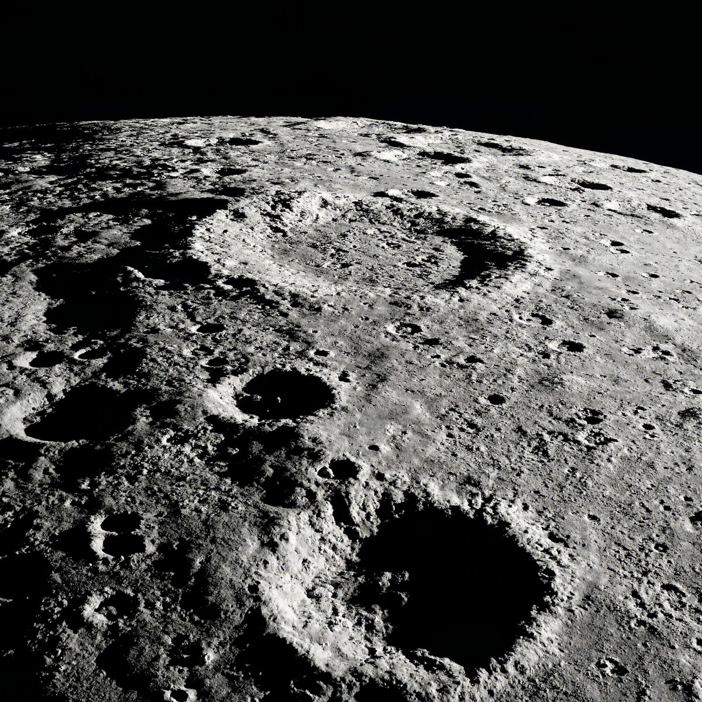

<p align="center">
  <picture>
    
  </picture>
</p>

<p align="center">
  <a href="README.md"></a>
  
</p>

# onyx-infer

在 **Apple Silicon Mac 上本地直出 4096×4096 图像**。Onyx Infer 用 C++20 和 Metal 4 执行 MiniMax-H3-Image 的文本编码器、33.1B DiT 和 VAE。4K 出图已在配备 M5 Max 和 36 GB 统一内存的 Mac Studio 上验证。

[生成第一张图](docs/QUICKSTART.md) · [性能实测](#性能实测) · [Onyx Studio](plugin/onyx-studio/README.zh-CN.md)

PyTorch 和 Diffusers 用于离线导入和参考验证。原生推理由 MPSGraph 和 Metal 内核执行。

## 在 Apple Silicon 上生成

以下均为 Onyx 实际出图的缩放预览，原始生成分辨率见图注。

<table>
  <tr>
    <td align="center" width="50%"><br><b>骑自行车的鹈鹕</b><br><sub>4096×4096 · 16 MP 直出</sub></td>
    <td align="center" width="50%"><br><b>红玛瑙</b><br><sub>4096×4096 · 16 MP 直出</sub></td>
  </tr>
  <tr>
    <td align="center"><br><b>月球表面</b><br><sub>4096×4096 · 16 MP 直出</sub></td>
    <td align="center"><br><b>摩卡壶蓝图</b><br><sub>1024×1024 · W4 · 短标题逐字准确</sub></td>
  </tr>
</table>

## 为什么要有这个项目

H3 原始权重约 **135 GB**。M5 Max 基准机推荐的 GPU 工作集上限为 28.08 GiB。
Onyx 通过分组 W4 量化、权重流式读取和分块注意力，在该预算内运行 H3。

## 核心特性

- **原生推理**。在 Apple Silicon 上使用 MPSGraph 和 Metal 内核，流式读取分组 W4 权重。
- **16 MP 直出**。支持 4096×4096 生成与 VAE 分块解码。
- **可回放的运行记录**。使用版本化的 Protobuf 契约、RunRecord 和 SHA-256 校验。
- **版本化模型包**。固定上游版本，支持断点续传和逐文件 SHA-256 校验。

## 性能实测

使用 H3 W4 茶壶请求、种子 42、六步采样和 `max-quality` 档位。峰值内存为采样所得的进程树 RSS。

| 设备 | 分辨率 | 耗时 | 峰值 RSS | 测量记录 |
| --- | --- | ---: | ---: | --- |
| M5 Max，36 GB | 1024×1024 | 19.58 秒（3 次中位数） | 1.71 GiB | [1024×1024 测量记录](benchmarks/results/campaign-20261123/against-main-1024.json) |
| M5 Max，36 GB | 4096×4096 | 227.93 秒（1 次） | 1.91 GiB | [4096×4096 测量记录](benchmarks/results/campaign-20261123/against-main-4096.json) |
| MacBook Air M4，24 GB | 1024×1024 | 174.98 秒（3 次中位数） | 1.79 GiB | [v0.3.1，电池供电](benchmarks/results/m4-air-24gb-dit-prefetch-v1.json) |

M5 Max 的两组测量均命中 DiT 调制缓存。首次请求需要计算调制表。[基准方法与完整结果](docs/OPTIMIZATION_CAMPAIGN.md)

## 快速开始

[从零生成第一张图](docs/QUICKSTART.md)列出了原生构建、锁定版本下载、W4 转换和 1024×1024 出图的完整命令。

- **系统** — Apple Silicon、macOS 26.2 或更新版本、Xcode Metal 4 工具链，以及 `uv` 和 Python 3.12 或更新版本。
- **磁盘** — W4 推理文件约 **62 GB**，包含 VAE、PDD heads 和 tokenizer。原始权重与转换产物合计预留约 **200 GB**，构建工具另计。
- **已实测机型** — M4 Air（24 GB）和 M5 Max（36 GB）均完成 1024×1024 出图。统一内存下限尚未验证。

默认档位为 `max-quality`。使用 `memory-min` 可流式读取 VAE 权重。M5 上的 `m5-fast` 使用神经网络加速器，采用不同的数值路径。`speed-focus` 用于评估 BF16 SIMD 和 DiT 权重缓存。[执行档位](docs/PROFILES.md)

原生推理默认将 DiT 调制表缓存在 `~/Library/Caches/onyx-infer/modulation`。可通过 `--modulation-cache <目录>` 指定位置，或使用 `--no-modulation-cache` 关闭缓存。[原生推理调优](docs/NATIVE_TUNING.md)

[Onyx Studio](plugin/onyx-studio/README.zh-CN.md) 为 DeepSeek Harness 提供本地出图、引擎观测和图文阅读器。生成图中文字和标注可参阅[图中文字指南](docs/IMAGE_TEXT.md)。

## 文档

| 文档 | 内容 |
| --- | --- |
| [docs/ARCHITECTURE.md](docs/zh-CN/ARCHITECTURE.md) | 产品定位、来自官方资料的约束、模块边界 |
| [docs/PROTOCOLS.md](docs/zh-CN/PROTOCOLS.md) | 六组版本化 Protobuf 契约 |
| [docs/LOOP.md](docs/zh-CN/LOOP.md) | Loop Engineering 与受控 RSI |
| [docs/V1_REVIEW.md](docs/V1_REVIEW.md) | v1 冻结评审与验收证据 |
| [docs/PROFILES.md](docs/PROFILES.md) | 执行档位与验收门禁 |
| [docs/ACCELERATION.md](docs/zh-CN/ACCELERATION.md) | 加速方案与验证优先级 |
| [docs/BENCHMARKS.md](docs/BENCHMARKS.md) | 基准能力报告（自动聚合生成） |
| [docs/VALIDATION.md](docs/VALIDATION.md) | 本地与硬件验证 |
| [docs/LORA_ADAPTERS.md](docs/zh-CN/LORA_ADAPTERS.md) | LoRA 适配器说明 |
| [CONTRIBUTING.md](CONTRIBUTING.md) | 贡献入口 |

项目主页与工程博客：**https://phantom5125.github.io/onyx-infer/**
（源码在 [`site/`](site/)，博客由 [`tools/build_blog.py`](tools/build_blog.py) 构建）。

## 用参考图编辑

Apple Silicon 上的 CLI 可以用 H3 W4 模型编辑图像，每次最多传入 16 张参考图。从当前源码构建引擎并安装可选的 `reference` 依赖。每张图写一个 `--reference`，提示词中的 `<Picture 1>`、`<Picture 2>` 按传入顺序对应图片。

```bash
uv run --frozen --no-dev --extra reference onyx native-generate \
  --models artifacts/models/h3-w4 \
  --reference room.png --reference chair.png \
  --prompt '把 <Picture 2> 里的椅子放进 <Picture 1> 的房间。' \
  --output artifacts/edit.png
```

[参考图编辑指南](docs/QUICKSTART.md#edit-with-reference-images)说明了安装、输入限制、回放用法和 DiT 实验性内存优化开关。

## 指南

工程博客上已发布的指南，按时间倒序：

- [2026-11-18：四轮优化，一只逐字节一致的 teapot](site/blog/posts/four-rounds-one-byte-identical-teapot.md)——四项早期内核与权重读取实验的测量记录。
- [2026-11-18：36 GB 统一内存上的十六百万像素](site/blog/posts/sixteen-megapixels-on-36gb.md)——引擎如何为 4096×4096 直出管理内存。
- [2026-11-18：为什么从零写一个推理引擎](site/blog/posts/why-native-from-scratch.md)——135 GB → 28.08 GiB 的数学，以及由此得出的设计原则。

## 许可证

Onyx Infer 自有源码采用 [MIT 许可证](LICENSE)。仓库内的 MLX 代码及其派生部分保留 [Apple MLX 许可证](ops/metal/mlx_root/LICENSE)。参考图编码器包含改编自 h3-image-mlx 的代码，采用 [Apache-2.0](LICENSE.h3-image-mlx)。H3 模型文件须单独获取，适用 [MiniMax 上游许可证](https://github.com/MiniMax-AI/MiniMax-H3-Image/blob/main/LICENSE)。

## 引用

如果 onyx-infer 对你的研究有帮助，欢迎按如下格式引用：

```bibtex
@misc{onyx-infer,
  author = {Daocheng Ying},
  title = {onyx-infer: native image generation for Apple Silicon},
  year = {2026},
  publisher = {GitHub},
  url = {https://github.com/phantom5125/onyx-infer}
}
```
