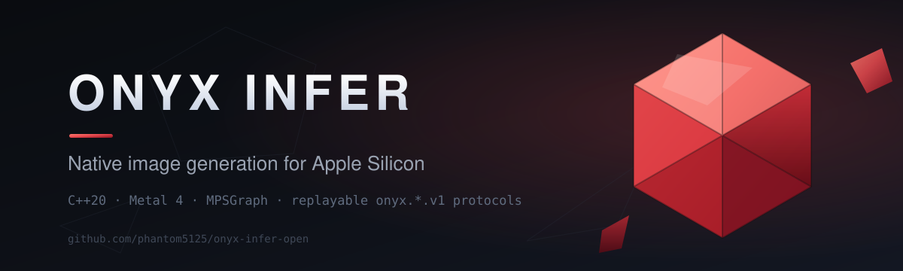
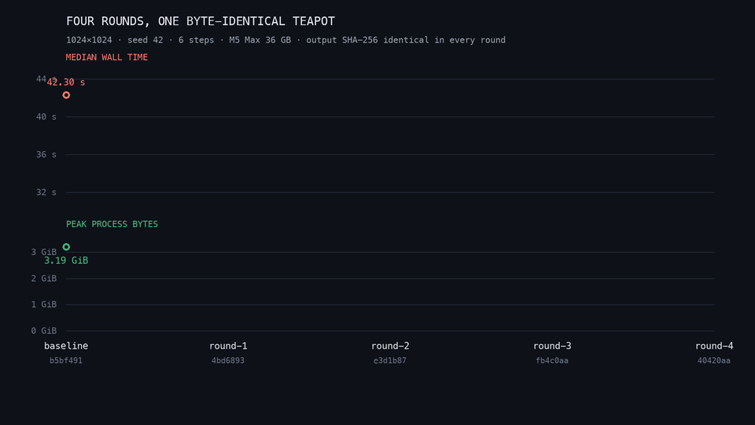

<p align="center">
  <picture>
    
  </picture>
</p>

<p align="center">
  <a href="README.md"></a>
  
</p>

# onyx-infer

在 **Apple Silicon Mac 上本地直出 4096×4096 图像**。Onyx Infer 用 C++20 和 Metal 4 执行 MiniMax-H3-Image 的文本编码器、33.1B DiT 和 VAE。4K 出图已在配备 M5 Max 和 36 GB 统一内存的 Mac Studio 上验证。

[快速开始](#快速开始) · [选择档位](#选择档位) · [深度评测](#深度评测) · [Onyx Studio](plugin/onyx-studio/README.zh-CN.md)

六步 4096×4096 茶壶基准在 36 GB M5 Max 上耗时 329.6 秒。24 GB M4 MacBook Air 在电池供电下生成 1024×1024 茶壶图的中位数约为 175 秒。[M5 Max 基准](benchmarks/results/native-v1-stability.json) · [M4 Air 基准](benchmarks/results/m4-air-24gb-dit-prefetch-v1.json)

PyTorch 和 Diffusers 用于离线导入和参考验证。原生推理由 MPSGraph 和 Metal 内核执行。

## 快速开始

从克隆到生成第一张原生 1024×1024 图像只需四步。完整指南与故障排查见 [docs/QUICKSTART.md](docs/QUICKSTART.md)。

**1. 构建原生运行时**

```bash
git clone --branch v0.4.0 https://github.com/phantom5125/onyx-infer.git
cd onyx-infer
uv sync --frozen --no-dev
uvx --from cmake cmake -S . -B .build -DCMAKE_BUILD_TYPE=Release -DONYX_ENABLE_MLX=OFF
uvx --from cmake cmake --build .build --target onyx-native --parallel 8
```

**2. 下载锁定版本的模型权重并转换为 W4**

```bash
uv run --frozen --no-dev python tools/modelscope_fetch.py \
  --source-lock config/sources/h3-image-files.json --directory artifacts/models/h3-image-source
uv run --frozen --no-dev onyx import \
  --source artifacts/models/h3-image-source --lock config/sources/h3-image-files.json \
  --output artifacts/models/h3-original-meta
uv run --frozen --no-dev onyx quantize --source artifacts/models/h3-image-source \
  --component text_encoder --all-linear --output artifacts/models/h3-w4/text_encoder.onxpack
uv run --frozen --no-dev onyx quantize --source artifacts/models/h3-image-source \
  --component transformer --all-linear --output artifacts/models/h3-w4/transformer.onxpack
uv run --frozen --no-dev onyx package-w4 --source artifacts/models/h3-image-source \
  --original-manifest artifacts/models/h3-original-meta/manifest.pb --output artifacts/models/h3-w4
```

**3. 生成**

```bash
uv run --frozen --no-dev onyx native-generate \
  --models artifacts/models/h3-w4 \
  --prompt "A yellow enamel teapot on a blue wooden table." \
  --width 1024 --height 1024 --seed 42 \
  --output artifacts/native-output.png
```

**你需要准备**

- **系统** — Apple Silicon、macOS 26.2 或更新版本、Xcode Metal 4 工具链，以及 `uv` 和 Python 3.12 或更新版本。
- **磁盘** — W4 推理文件约 **62 GB**。原始权重与转换产物合计预留约 **200 GB**，构建工具另计。
- **内存** — 1024×1024 出图已在 24 GB（M4 Air）和 36 GB（M5 Max）机型上实测。统一内存下限尚未验证。
- **耗时** — M5 Max 上每张 1024×1024 约 35–43 秒，M4 Air 上约 175 秒。实测数据见下文。

## 选择档位

同一份 W4 模型，三种执行档位。档位只改变执行计划——权重、采样器和种子完全相同，因此选择只关乎内存与速度，不影响图像内容。[档位注册表](config/profiles/profiles.v1.json) · [验收门禁](docs/PROFILES.md)

| 档位 | 执行计划 | 什么时候选 | VAE 阶段实测（M5 Max） |
| --- | --- | --- | --- |
| `max-quality`（默认） | 文本与 DiT 流式读取；VAE 驻留；MPSGraph FP32 反量化 | 想要端到端实测最快的路径 | 6.30 s @1024 · 85.23 s @4096 |
| `memory-min` | 全部阶段流式读取，包括 VAE | 想要最低内存占用；输出与 `max-quality` 逐字节一致 | 10.25 s @1024 · 155.28 s @4096 |
| `speed-focus` | BF16 SIMD Q4 内核 + 24 GiB DiT LRU 缓存 | 试验内核与缓存变体 | 5.55 s @1024 · 97.40 s @4096 |

怎么读这些数字：上表 VAE 阶段矩阵使用 FP32 源权重、每组三次轮换采样，在 36 GB 基准机上测得。端到端来看，默认 MPSGraph 路径仍是实测最快的 W4 管线——`speed-focus` 是试验田，不是捷径。`memory-min` 的全程流式方案在 1024×1024 下 VAE 耗时约多 63%、4096×4096 下约多 82%，换来的是完全不驻留 VAE 权重，且输出与 `max-quality` 逐字节一致（这是硬性门禁，不是期望）。

显式指定档位运行：

```bash
uv run --frozen --no-dev onyx native-generate --profile memory-min \
  --models artifacts/models/h3-w4 --prompt "..." --width 1024 --height 1024 --seed 42 \
  --output artifacts/native-output.png
```

连续出图时可加 `--modulation-cache <目录>`，在不同提示词、种子和画幅之间复用六步 DiT 调制表（基准机上中位数 38.21 s vs 43.14 s）。36 GB 机型上跑 1024×1024 可用 `--dit-cache-mib 10240` 缓存反复读取的权重；同样的预算在 16 MP 下会增加 swap。[调优与验证](docs/NATIVE_TUNING.md)

## 为什么要有这个项目

原始权重约 **135 GB**，本机 GPU 可用预算 28.08 GiB。这个差距决定了全部架构：
group-wise W4 量化、分阶段驻留、逐 block 流式、分块注意力，以及一个显式做内存规划的
引擎，而不是指望统一内存自动解决一切。

## 优化榜单

所有配置都在 M5 Max 36 GB 上使用同一条 1024×1024 茶壶请求（seed 42，六步采样）。
四项优化的 PNG 都与基线逐字节一致。测量文件记录了样本数、输出哈希和提交版本。

| 配置 | 墙钟时间中位数 | 峰值内存 | 相对基线 | 测量 |
|---|---:|---:|---:|---|
| 原生流式基线 | 42.30 s | 3.19 GiB | 1.00× | [基线测量](benchmarks/results/native-round1-zero-cache.json) |
| 分组 Q4 零点缓存 | 42.63 s | 3.18 GiB | 0.99× | [测量](benchmarks/results/native-round1-zero-cache.json) |
| 权重直读 Metal 缓冲区 | 38.74 s | 1.70 GiB | 1.09× | [测量](benchmarks/results/native-round2-direct-pread.json) |
| 共享内存 BF16 调制打包 | 37.50 s | 1.70 GiB | 1.13× | [测量](benchmarks/results/native-round3-cpu-modulation.json) |
| 融合 DiT 注意力和张量视图 | **34.65 s** | 1.86 GiB | **1.22×** | [测量](benchmarks/results/native-round4-fused-attention-views.json) |

<picture>
  
</picture>

图表由已提交的测量 JSON 生成——可用 `uv run python tools/build_progress_chart.py` 重新生成。
完整记录见[茶壶基准文章](site/blog/posts/four-rounds-one-byte-identical-teapot.md)，包括回退的那一轮。

## 深度评测

以下所有数字都来自 [`benchmarks/results/`](benchmarks/results/) 中已提交的测量文件——包括我们尚未弥合的差距。
这些数据的机器聚合版本见 [docs/BENCHMARKS.md](docs/BENCHMARKS.md)。

### 端到端：跨机型、跨分辨率

六步 W4 茶壶请求，seed 42。RSS 为对整个推理进程树的采样值。

| 机型 | 请求 | 耗时 | 峰值内存 | 证据 |
| --- | --- | ---: | ---: | --- |
| Mac Studio M5 Max · 36 GB | 1024×1024，最佳实测配置 | **34.65 s** 中位数 | 1.86 GiB | [native-round4](benchmarks/results/native-round4-fused-attention-views.json) |
| Mac Studio M5 Max · 36 GB | 1024×1024，默认档位，缓存关闭 | 43.14 s 中位数 | 1.91 GB | [调制缓存研究](benchmarks/results/m5-max-36gb-dit-modulation-cache-v1.json) |
| Mac Studio M5 Max · 36 GB | 1024×1024，调制缓存命中 | 38.21 s 中位数 | 1.92 GB | [调制缓存研究](benchmarks/results/m5-max-36gb-dit-modulation-cache-v1.json) |
| Mac Studio M5 Max · 36 GB | 4096×4096 | 329.61 s 稳定性运行；当前二进制单次 302.26 s | 2.14 GB | [native-v1-stability](benchmarks/results/native-v1-stability.json) · [4096 对照](benchmarks/results/m5-max-36gb-dit-modulation-cache-v1.json) |
| MacBook Air M4 · 24 GB · 电池 | 1024×1024 | 174.98 s 中位数 | 1.92 GB | [m4-air-24gb](benchmarks/results/m4-air-24gb-dit-prefetch-v1.json) |

### 时间花在哪（1024×1024 茶壶，各阶段中位数）

| 机型 | 文本编码器 | DiT（6 步） | VAE 解码 |
| --- | ---: | ---: | ---: |
| M5 Max，基线 | 4.81 s | 33.24 s | 4.85 s |
| M5 Max，第 4 轮 | 3.83 s | 26.02 s | 4.41 s |
| M4 Air，电池 | 9.90 s | 143.48 s | 19.99 s |

DiT 阶段在所有机型上都占墙钟时间的 75–82%，这正是优化 Loop 集中于此的原因，
也是下面的算子级差距比其他差距更重要的原因。

### 算子级：Q4 GEMM 对比 MLX（已发布的差距）

与 H3 DiT/文本塔相同的形状，group size 64，一次预热后的墙钟中位数。
这是当前内核攻关正在弥合的差距——各轮次的 Episode 记录见
[`kernel-agent/candidates.jsonl`](kernel-agent/candidates.jsonl)。

| 形状 | Onyx tile16 | MLX `quantized_matmul` | 差距 | Onyx tile32 变体 |
| --- | ---: | ---: | ---: | ---: |
| linear m1024 · n5376 · k5376 | 28.12 ms | 1.71 ms | 16.5× | — |
| qkv m1024 · n21504 · k5376 | 109.77 ms | 5.48 ms | 20.0× | 65.65 ms（1.67×） |
| text qproj m69 · n8192 · k5120 | 3.29 ms | 0.77 ms | 4.3× | 2.44 ms（1.35×） |

[算子对比](benchmarks/results/m5-max-36gb-q4-operator-v1.json) · [tile32 测量](benchmarks/results/m5-max-36gb-q4-tile32-v1.json)

### 对比社区 W8A8 方案

同一条 1024 茶壶请求：社区 MLX 管线（W8A8，权重驻留）中位数 23.61 s、峰值 13.77 GB；
原生 Onyx W4 为 38.74 s、1.70 GiB——慢 1.64×，但内存约为前者的八分之一。
两者量化方式与执行实现不同，因此这不是对等的速度结论；它是下一个优化目标，
我们选择公开发布而不是略过。[对比记录](benchmarks/results/h3-teapot-1024-comparison-v1.json)

### 数值保真

| 检查项 | 结果 | 来源 |
| --- | --- | --- |
| 文本塔 vs FP32 参考 | 相关系数 0.9999987 | `native-baseline-v1.json` |
| VAE 解码 vs FP32 参考 | 像素相关系数 0.999993 | `native-baseline-v1.json` |
| 全部四轮优化 | 输出 SHA-256 逐字节一致 | `native-round{1..4}` JSON |
| `memory-min` vs `max-quality` | 逐字节一致（硬性门禁） | [档位矩阵](benchmarks/results/profile-stage-matrix-v1.json) |

## 核心特性

- **全原生链路，运行时零复用**——MPSGraph + 手写 MSL kernel，加载自有 packed Q4 权重；
  分阶段流式执行，VAE tiling。
- **16 MP 直出**——4096×4096 由 DiT 直接生成（每 token 对应 32×32 像素），无独立
  upscaler。该次茶壶基准耗时 329.6 秒，采样到的进程树峰值 RSS 为 2.14 GB。
- **可回放的 v1 协议**——六组版本化 Protobuf 契约（`onyx.common/job/model/plan/trace/loop.v1`）；
  每次运行写入 RunRecord；输出经 SHA-256 校验并可回放复现。
- **证据先行的优化 Loop**——上面的榜单不是叙事；每一轮都有测量 JSON、正确性门与
  输出哈希证明作为支撑。
- **版本化不可变模型包**——ModelScope revision 固定、逐文件 SHA-256、多段续传下载、
  流式 group-wise W4 打包。
- **W4 的三档执行配置**——`max-quality` 使用默认 MPSGraph，`memory-min` 全阶段流式读取，
  `speed-focus` 用于试验 BF16 SIMD 和权重缓存。档位注册表记录具体配置与验收门槛。

## 工具链

[Onyx Studio](plugin/onyx-studio/README.md) 为 DeepSeek Harness 提供本地出图、引擎观测和图文阅读器。

可用 `onyx label-prompt` 为 H3 组织文字提示。需要逐字准确的文字和引线时，可在生成后用 `onyx compose-labels` 排版。[图中文字工作流](docs/IMAGE_TEXT.md)

跨档基准矩阵、门禁检查与能力报告：

```bash
uv run python benchmarks/run_profiles.py --sizes 1024x1024,4096x4096 --runs 3 --output artifacts/benchmarks/profile-stage-matrix.json
uv run python tools/check_profile_gates.py artifacts/benchmarks/profile-stage-matrix.json
uv run python tools/build_benchmark_report.py
uv run python tools/build_progress_chart.py   # 重新生成榜单图表
```

MLX 参照环境独立安装：`uv sync --extra reference`。

## 文档

| 文档 | 内容 |
| --- | --- |
| [docs/QUICKSTART.md](docs/QUICKSTART.md) | 首张图完整指南与故障排查 |
| [docs/ARCHITECTURE.md](docs/zh-CN/ARCHITECTURE.md) | 产品定位、来自官方资料的约束、模块边界 |
| [docs/PROTOCOLS.md](docs/zh-CN/PROTOCOLS.md) | 六组版本化 Protobuf 契约 |
| [docs/LOOP.md](docs/zh-CN/LOOP.md) | Loop Engineering 与受控 RSI |
| [docs/V1_REVIEW.md](docs/V1_REVIEW.md) | v1 冻结评审与验收证据 |
| [docs/PROFILES.md](docs/PROFILES.md) | 执行档位与验收门禁 |
| [docs/ACCELERATION.md](docs/zh-CN/ACCELERATION.md) | 加速路线：投机解码适配性评估、Mac 特性抓手、infra 团队建议 |
| [docs/BENCHMARKS.md](docs/BENCHMARKS.md) | 基准能力报告（自动聚合生成） |
| [docs/VALIDATION.md](docs/VALIDATION.md) | 本地与硬件验证 |
| [docs/LORA_ADAPTERS.md](docs/zh-CN/LORA_ADAPTERS.md) | LoRA 适配器说明 |
| [CONTRIBUTING.md](CONTRIBUTING.md) | 贡献入口 |

项目主页与工程博客：**https://phantom5125.github.io/onyx-infer/**
（源码在 [`site/`](site/)，博客由 [`tools/build_blog.py`](tools/build_blog.py) 构建）。

## 指南

工程博客上已发布的指南，按时间倒序：

- [2026-11-18：四轮优化，一只逐字节一致的 teapot](site/blog/posts/four-rounds-one-byte-identical-teapot.md)——榜单背后的完整故事，包括回退的那一轮。
- [2026-11-18：36 GB 统一内存上的十六百万像素](site/blog/posts/sixteen-megapixels-on-36gb.md)——引擎如何为 4096×4096 直出管理内存。
- [2026-11-18：为什么从零写一个推理引擎](site/blog/posts/why-native-from-scratch.md)——135 GB → 28.08 GiB 的数学，以及由此得出的设计原则。

## 许可证

Onyx Infer 自有源码采用 [MIT 许可证](LICENSE)。仓库内的 MLX 代码及其派生部分保留 [Apple MLX 许可证](ops/metal/mlx_root/LICENSE)。H3 模型文件须单独获取，适用 [MiniMax 上游许可证](https://github.com/MiniMax-AI/MiniMax-H3-Image/blob/main/LICENSE)。

## 引用

如果 onyx-infer 对你的研究有帮助，欢迎按如下格式引用：

```bibtex
@misc{onyx-infer,
  author = {Daocheng Ying},
  title = {onyx-infer: native image generation for Apple Silicon},
  year = {2026},
  publisher = {GitHub},
  url = {https://github.com/phantom5125/onyx-infer}
}
```
